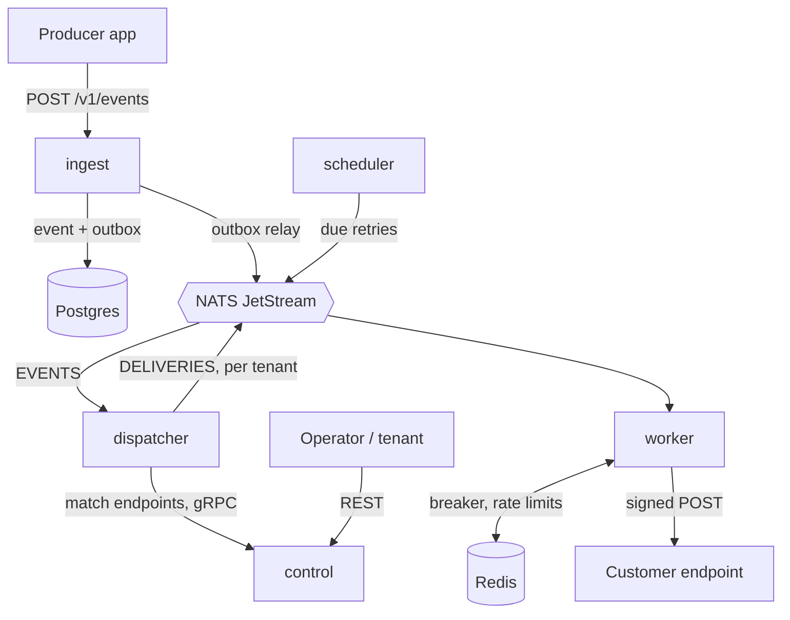

# Hookline


Self-hosted, multi-tenant webhook delivery in Go. Send an event once; Hookline stores it, fans it out to every subscribed endpoint, and delivers it as a signed [Standard Webhooks](https://www.standardwebhooks.com/) request with retries, circuit breakers, rate limits, per-tenant fairness and dead-letter replay.

## Architecture



Postgres is the source of truth, NATS carries ID-only jobs, Redis holds rebuildable shared state. Delivery is at-least-once with idempotent hops. More in [docs/architecture.md](docs/architecture.md).

## Features

- Tenants, scoped API keys, endpoints with event-type subscriptions
- Single and batch ingest with idempotency keys
- HMAC-SHA256 signatures with zero-downtime secret rotation
- Retries over ~28 h with jitter and `Retry-After` support
- Shared per-endpoint circuit breaker, GCRA rate limits, per-tenant fair scheduling
- Dead letters and replay; full delivery/attempt history
- SSRF protection at dial time
- Prometheus, OpenTelemetry traces, Grafana dashboards, SLO alerts

## Quick start

Requires Docker, Go 1.27 and make.

```bash
make compose-up   # writes .env, builds and starts everything
make seed         # demo tenants and endpoints
make demo         # 60 s of traffic
```

Ingest on `:8080`, control on `:8082`, Grafana on `:3000`.

Kubernetes (k3d): `make cluster-up deploy-local seed demo`.

## Send an event

```bash
curl -X POST localhost:8080/v1/events -H "Authorization: Bearer $KEY" \
  -d '{"event_type":"order.created","payload":{"id":42},"idempotency_key":"order-42"}'
```

API contract: [proto/hookline/v1](proto/hookline/v1) and [OpenAPI](gen/openapi/hookline.swagger.json). Config: [.env.example](.env.example).

## Verify on the receiver

```go
wh, _ := standardwebhooks.NewWebhook(secret)
if err := wh.Verify(body, r.Header); err != nil { /* 401 */ }
```

Reply `2xx` within 15 s to ack, `410` to unsubscribe, `429`/`503` with `Retry-After` to slow down. Deduplicate on `webhook-id`.

## Test

```bash
make test               # unit
make test-integration   # Postgres, NATS, Redis via testcontainers
make test-e2e           # scenarios against the running stack
```
