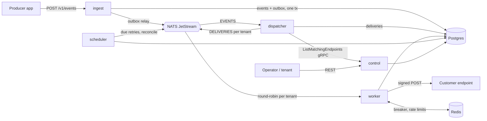

# Hookline

Hookline is a self-hosted, multi-tenant webhook delivery platform written in Go. Producer apps send events to an API; Hookline stores them durably and delivers them as signed [Standard Webhooks](https://www.standardwebhooks.com/) to every subscribed endpoint, with retries over ~28 hours, circuit breakers, per-endpoint rate limits, per-tenant fairness, a dead letter queue with replay, and full metrics, logs and traces. It runs on one 16 GB machine.

> Work in progress. See [PROGRESS.md](PROGRESS.md) for milestone status.

## Architecture



Postgres is the source of truth; NATS only carries ID-only jobs; Redis holds shared fast state. See [docs/adr](docs/adr).

## Quick start (Docker Compose)

```bash
make compose-up   # creates .env with random secrets on first run, builds and starts everything
make seed         # demo tenants, keys, event types, endpoints on the chaos customer
make demo         # 60 s of traffic across three tenants
```

Then check the receiver: `go run ./cmd/hookctl chaos stats`, and Grafana at http://localhost:3000.

| Service | URL |
| --- | --- |
| ingest REST | http://localhost:8080 |
| control REST | http://localhost:8082 |
| chaos customer | http://localhost:9000 |
| Grafana | http://localhost:3000 |
| Prometheus | http://localhost:9091 |

## API at a glance

```bash
# admin: create a tenant and a key
curl -s -X POST localhost:8082/v1/admin/tenants -H "Authorization: Bearer $HOOKLINE_ADMIN_KEY" -d '{"name":"acme"}'
curl -s -X POST localhost:8082/v1/admin/tenants/ten_.../keys -H "Authorization: Bearer $HOOKLINE_ADMIN_KEY" -d '{}'

# tenant: catalogue, endpoint, event
curl -s -X POST localhost:8082/v1/event-types -H "Authorization: Bearer $KEY" -d '{"name":"order.created"}'
curl -s -X POST localhost:8082/v1/endpoints  -H "Authorization: Bearer $KEY" -d '{"url":"https://example.com/hook","event_types":["*"]}'
curl -s -X POST localhost:8080/v1/events     -H "Authorization: Bearer $KEY" -d '{"event_type":"order.created","payload":{"id":42},"idempotency_key":"order-42"}'

# dead letters and replay
curl -s "localhost:8082/v1/deliveries?status=dead" -H "Authorization: Bearer $KEY"
curl -s -X POST localhost:8082/v1/deliveries/dlv_...:replay -H "Authorization: Bearer $KEY" -d '{}'
```

The full contract is in [proto/hookline/v1](proto/hookline/v1) and [gen/openapi/hookline.swagger.json](gen/openapi/hookline.swagger.json).

## Development

Prerequisites: Go 1.27, Docker, make. `make tools` installs pinned buf, protoc plugins, golangci-lint and govulncheck.

```bash
make gen     # protobuf, gateway, OpenAPI and sqlc code
make lint
make test
make build
```
