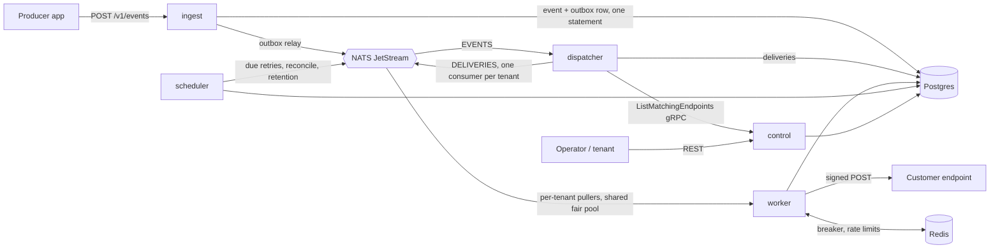

# Hookline

Hookline is a self-hosted, multi-tenant webhook delivery platform written in Go. Producer apps send events to an API; Hookline stores each one durably, fans it out to every subscribed endpoint, and delivers it as a signed [Standard Webhooks](https://www.standardwebhooks.com/) request. Retries back off over ~28 hours with jitter. Each endpoint gets a circuit breaker and a rate limit, each tenant gets a fair share of delivery capacity, and dead letters can be replayed. Every event is one trace across all services. It runs on a single 16 GB machine with Docker Compose or a local k3d cluster, and on a Windows home server.

[](https://github.com/GitNimay/hookline/actions/workflows/ci.yml)

## Architecture



Postgres is the source of truth, NATS carries jobs that contain only IDs, and Redis holds shared state that can be rebuilt. Details are in [docs/architecture.md](docs/architecture.md) and the decision records are in [docs/adr](docs/adr).

## Features

- Tenants and API keys (admin and tenant scopes, rotation, revocation)
- Endpoints with subscribed event types (`*` wildcard), custom headers, a per-endpoint rate limit, enable/disable, and soft delete
- A per-tenant event type catalogue that subscriptions and events are validated against
- Single and batch ingestion (up to 100 per request) with idempotency keys; a repeated key returns `200` and the original ID
- Fan-out: one delivery per matching endpoint
- Standard Webhooks headers and HMAC-SHA256 signatures; secret rotation signs with both secrets for a 24 h overlap
- Retries on `default` (8 attempts over ~28 h) or `demo` schedules with +0–20% jitter, honouring `Retry-After`
- A Redis circuit breaker per endpoint that all pods share, with a half-open single probe and exponential re-open
- Endpoints disabled automatically after 3 days of failures or on `410 Gone`
- GCRA rate limits per tenant (ingest) and per endpoint (delivery); fails open if Redis is down
- Per-tenant fairness: one JetStream consumer per tenant, `MaxAckPending` as a bulkhead, and a FIFO-fair worker pool
- Dead letters and replay of one delivery, all dead deliveries of an endpoint, or everything since a time
- Delivery and attempt history with status code, latency and the first 4 KB of the response
- A test-send endpoint
- SSRF protection enforced at dial time (private, loopback, link-local/metadata, CGNAT and ULA addresses; no redirects)
- Prometheus metrics, JSON logs with trace IDs, OpenTelemetry traces through NATS, four Grafana dashboards, alert rules including multi-window SLO burn alerts
- A chaos customer with configurable failures and the `hookctl` CLI for admin tasks, seeding and load generation

## Quick start: Docker Compose

Prerequisites: Docker, Go 1.27, make.

```bash
make compose-up   # first run writes .env with random secrets, builds and starts everything
make seed         # three demo tenants, event types, endpoints on the chaos customer
make demo         # 60 s of traffic across the tenants
go run ./cmd/hookctl chaos stats
```

| Service | URL |
| --- | --- |
| ingest REST | http://localhost:8080 |
| control REST | http://localhost:8082 |
| chaos customer | http://localhost:9000 |
| Grafana (folder *Hookline*) | http://localhost:3000 |
| Prometheus / Alertmanager | http://localhost:9091 / http://localhost:9093 |

To also run Tempo, Loki and Alloy (traces and logs in Grafana), use `make compose-up-tracing`.

## Quick start: local Kubernetes (k3d)

Prerequisites: Docker, k3d, kubectl, helm, helmfile, make (see [docs/homeserver-setup.md](docs/homeserver-setup.md) for install commands). Give WSL2/Docker at least 10 GB RAM and 4 CPUs, and keep at least 25 GB free on the disk that holds Docker's data.

```bash
make cluster-up deploy-local seed demo
```

`cluster-up` creates a cluster with 1 server and 2 agents, generates secrets, and installs cert-manager, kube-prometheus-stack, Loki, Tempo, Alloy, NATS, CloudNativePG, Redis and KEDA. `deploy-local` builds and imports the images and installs the Hookline chart. The API is at `http://hookline.localhost:8080` and Grafana at `http://grafana.localhost:8080`. `tilt up` gives a rebuild-on-save loop. `make chaos` installs Chaos Mesh and applies the experiments in `deploy/chaos/`.

## API overview

```bash
# admin: tenant and key
curl -s -X POST localhost:8082/v1/admin/tenants -H "Authorization: Bearer $HOOKLINE_ADMIN_KEY" -d '{"name":"acme"}'
curl -s -X POST localhost:8082/v1/admin/tenants/ten_.../keys -H "Authorization: Bearer $HOOKLINE_ADMIN_KEY" -d '{}'

# tenant: catalogue, endpoint, secret
curl -s -X POST localhost:8082/v1/event-types -H "Authorization: Bearer $KEY" -d '{"name":"order.created"}'
curl -s -X POST localhost:8082/v1/endpoints  -H "Authorization: Bearer $KEY" \
     -d '{"url":"https://example.com/hook","event_types":["*"],"rate_limit_per_sec":50}'
curl -s localhost:8082/v1/endpoints/ep_.../secret -H "Authorization: Bearer $KEY"

# events (202 on accept, 200 on a repeated idempotency key)
curl -s -X POST localhost:8080/v1/events -H "Authorization: Bearer $KEY" \
     -d '{"event_type":"order.created","payload":{"id":42},"idempotency_key":"order-42"}'
curl -s -X POST localhost:8080/v1/events:batch -H "Authorization: Bearer $KEY" -d '{"events":[...]}'

# history, dead letters, replay
curl -s "localhost:8082/v1/deliveries?status=dead&endpoint_id=ep_..." -H "Authorization: Bearer $KEY"
curl -s localhost:8082/v1/deliveries/dlv_.../attempts -H "Authorization: Bearer $KEY"
curl -s -X POST localhost:8082/v1/deliveries/dlv_...:replay -H "Authorization: Bearer $KEY" -d '{}'
curl -s -X POST localhost:8082/v1/endpoints/ep_...:replay   -H "Authorization: Bearer $KEY" -d '{"since":"2026-10-25T10:00:00Z"}'
curl -s -X POST localhost:8082/v1/endpoints/ep_.../secret:rotate -H "Authorization: Bearer $KEY" -d '{}'
curl -s -X POST localhost:8082/v1/endpoints/ep_...:test -H "Authorization: Bearer $KEY" -d '{}'
```

Errors use gRPC codes mapped to HTTP (400, 401, 403, 404, 409, 429 with `Retry-After`, 503) with a `code`, a `message` and field violations. Lists are cursor-paginated (`page_size` ≤ 100, `page_token`). The full contract is in [proto/hookline/v1](proto/hookline/v1) and [gen/openapi/hookline.swagger.json](gen/openapi/hookline.swagger.json).

## Verifying webhooks as a receiver

Each request carries `webhook-id` (the event ID: the same across retries and endpoints, so use it to deduplicate), `webhook-timestamp` and `webhook-signature`. Verify with any Standard Webhooks library and the endpoint's secret (`GET /v1/endpoints/{id}/secret`):

```go
import standardwebhooks "github.com/standard-webhooks/standard-webhooks/libraries/go"

wh, _ := standardwebhooks.NewWebhook(secret) // "whsec_..."
body, _ := io.ReadAll(r.Body)
if err := wh.Verify(body, r.Header); err != nil {
    http.Error(w, "bad signature", http.StatusUnauthorized)
    return
}
```

```js
import { Webhook } from "standardwebhooks";
new Webhook(secret).verify(rawBody, req.headers); // throws on a bad signature or a stale timestamp
```

Answer with `2xx` within 15 s to acknowledge, `410` to unsubscribe the endpoint, or `429`/`503` with `Retry-After` to slow Hookline down.

## How the reliability guarantees work

Delivery is **at-least-once**, and every hop is idempotent:

1. Ingest writes the event and an outbox row in one statement. A relay publishes the row to NATS with `Nats-Msg-Id = event_id` and only then marks it published (ADR-002).
2. The dispatcher inserts deliveries with `UNIQUE (event_id, endpoint_id)` and acks the event only after the deliveries are committed and their jobs published.
3. A worker claims a delivery with a conditional update and a lock, so a stale or duplicate job changes nothing. It records the attempt atomically and acks only after that (ADR-003).
4. Long retries live in Postgres (`next_attempt_at`), not in NATS. The scheduler publishes due retries under a lease and republishes any work whose job was lost (ADR-001).

A crash at any point leads to a retry and, at worst, a duplicate with the same `webhook-id`. The [architecture doc](docs/architecture.md#why-no-message-is-lost) walks through every failure case. The e2e suite kills workers and restarts NATS under load and checks that nothing is lost.

## Configuration

Every service reads environment variables with defaults, so the same image runs in Compose and Kubernetes. The full list with comments is in [.env.example](.env.example).

| Variable | Default | Used by | Meaning |
| --- | --- | --- | --- |
| `DATABASE_URL` | — (required) | all but chaos | Postgres DSN |
| `NATS_URL` | `nats://localhost:4222` | ingest, control, dispatcher, worker, scheduler | NATS server |
| `REDIS_ADDR` / `REDIS_PASSWORD` | `localhost:6379` / empty | ingest, control, worker | Redis |
| `HOOKLINE_MASTER_KEY` | — (required) | control, worker | base64 of 32 bytes; encrypts signing secrets |
| `HOOKLINE_ADMIN_KEY` | empty | control | bootstrap admin key (`hk_live_...`) |
| `GRPC_ADDR` / `HTTP_ADDR` / `ADMIN_ADDR` | `:9090` / `:8080` / `:8081` | all | listeners |
| `LOG_LEVEL` / `LOG_FORMAT` | `info` / `json` | all | logging |
| `OTEL_EXPORTER_OTLP_ENDPOINT` / `OTEL_TRACES_SAMPLER_RATIO` | empty / `1` | all | tracing |
| `DRAIN_DELAY` / `SHUTDOWN_TIMEOUT` | `5s` / `20s` | all | graceful shutdown |
| `DB_MAX_CONNS` / `DB_QUERY_TIMEOUT` | `20` / `5s` | all with DB | pgx pool |
| `DB_SYNCHRONOUS_COMMIT` | `true` | worker sets `false` | ADR-010 |
| `DEFAULT_INGEST_RPS` | `500` | ingest | fallback per-tenant ingest limit |
| `CONTROL_GRPC_ADDR` / `MATCH_CACHE_TTL` / `DISPATCHER_CONCURRENCY` | `localhost:9090` / `30s` / `32` | dispatcher | fan-out |
| `RETRY_SCHEDULE` | `default` | worker | `default`, `demo`, or durations like `5s,1m,10m` |
| `WORKER_CONCURRENCY` | `100` | worker | concurrent deliveries per pod |
| `SSRF_ALLOWLIST` | empty | worker, control | hosts allowed past the private-IP check |
| `ATTEMPT_RETENTION` / `EVENT_RETENTION` / `OUTBOX_RETENTION` | `336h` / `720h` / `24h` | scheduler | pruning |
| `IDEMPOTENCY_WINDOW` / `AUTO_DISABLE_AFTER` / `RECONCILE_PENDING_AFTER` | `24h` / `72h` / `10m` | scheduler | maintenance |
| `PPROF_ENABLED` | `false` | all | `/debug/pprof` on the admin port |

## Testing

```bash
make test               # unit tests (-race in CI)
make test-integration   # real Postgres, NATS and Redis via testcontainers
make test-e2e           # scenario suite against the running stack; E2E_DESTRUCTIVE=1 adds restarts
make loadtest           # k6 steady load (loadtest/: steady, spike, soak, noisy-neighbour)
```

CI runs generation checks, golangci-lint, `buf lint`/`buf breaking`, unit and integration tests with `-race`, govulncheck, `helm lint`/`helm template`, image builds and a Trivy scan. The e2e workflow runs the scenario suite and a k6 smoke test on Compose.

## Benchmarks

Measured on the development PC (Windows 11, Docker Desktop, Postgres on Docker's virtual disk). See [docs/benchmarks.md](docs/benchmarks.md) for the full tables, method and the reasons behind each miss.

## Operations

- [docs/runbook.md](docs/runbook.md): restart, scale, replay, rotate keys, back up and restore, and what each alert means
- [docs/homeserver-setup.md](docs/homeserver-setup.md): stage 2 on a Windows home server
- `make demo-full`: the 5-minute demo (steady load, failures and the breaker, a worker kill, a noisy neighbour, a dead letter and its replay)

## Roadmap (stretch goals)

Tenant weights in fair scheduling, mTLS between services, a read-only web UI for deliveries, payload transformations, optional per-endpoint ordering, OpenFeature flags, a multi-node home cluster.
