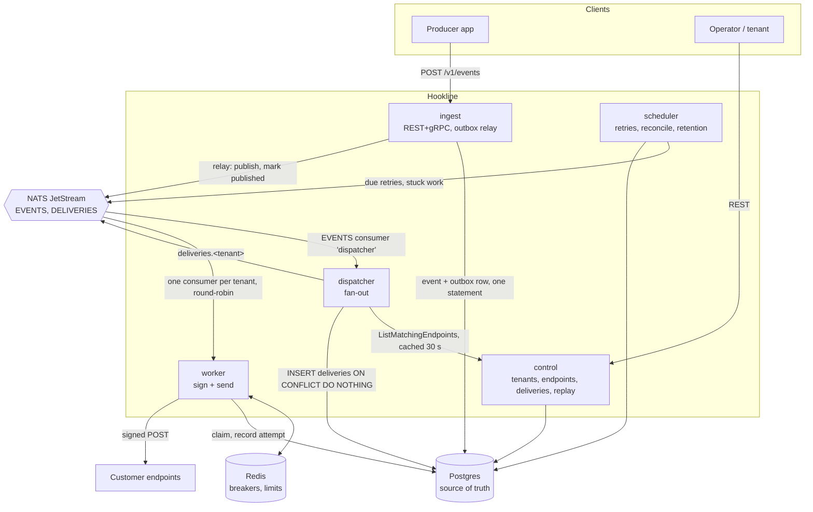
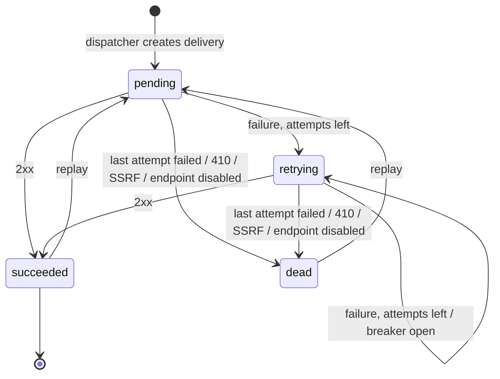

# Architecture

Hookline accepts events over a REST/gRPC API and delivers them as signed webhooks. Five Go services share one module; Postgres is the source of truth, NATS JetStream moves ID-only jobs between services, and Redis holds shared, rebuildable state (circuit breakers, rate limits).

## One event, step by step

1. **Ingest.** `POST /v1/events` reaches the grpc-gateway, which calls `IngestService.SendEvent` on the same pod. The handler authenticates the key (SHA-256 lookup, 30 s cache), checks the tenant's GCRA ingest limit in Redis, validates the payload (≤ 256 KB, type in catalogue) and runs one statement that inserts the `events` row and its `outbox` row. It answers `202` with the event ID (or `200` and the original ID for a repeated idempotency key) and stores the W3C `traceparent` with the event.
2. **Outbox relay.** Woken by the insert (or every 100 ms), the relay claims up to 500 unpublished rows with `FOR UPDATE SKIP LOCKED`, publishes each to `events.<tenant_id>` with `Nats-Msg-Id = event_id`, waits for the acks and marks those rows published in the same transaction.
3. **Dispatch.** The dispatcher pulls from the `EVENTS` work-queue stream, asks `control` which enabled endpoints subscribe to the type (cached 30 s), inserts one `deliveries` row per endpoint (`UNIQUE (event_id, endpoint_id)`), publishes one job per new delivery to `deliveries.<tenant_id>` and only then acks.
4. **Deliver.** Workers fetch round-robin across per-tenant consumers. For each job: endpoint disabled → dead; breaker open → reschedule to the reopen time without counting an attempt; rate limited → `NakWithDelay`; otherwise claim the delivery (conditional `UPDATE` with a 30 s lock, returning the payload), sign with every active secret, POST with a 15 s budget, classify the response, and record the attempt and the new state in one statement. Then update the breaker and ack.
5. **Retry.** A failed attempt sets `status = retrying` and `next_attempt_at` from the schedule (+0–20% jitter; `Retry-After` respected for 429/503). Every second the scheduler claims due rows, pushes `next_attempt_at` forward by a 5-minute lease and publishes their jobs. After the last attempt the delivery is `dead` and can be replayed.

## Delivery state machine

Every transition is a conditional `UPDATE ... WHERE status IN (...) AND attempt_count = $n`; zero rows changed means the job is stale or a duplicate and is acked without action (ADR-003).

## Why no message is lost

| Failure | What happens |
| --- | --- |
| ingest dies after commit, before relay | Outbox row stays unpublished; another ingest pod or the scheduler relays it. |
| NATS down | Ingest keeps accepting; the relay backs off; rows publish when NATS returns. Consumers reconnect forever. |
| dispatcher dies mid-event | Message is unacked → redelivered after 30 s; deliveries already inserted are read back and their jobs republished (deduped). |
| worker dies mid-delivery | The claim lock (30 s) expires; the unacked job is redelivered after 60 s and claimed again. The webhook may be sent twice with the same `webhook-id`. |
| a job message is lost | `pending` deliveries older than 10 minutes and `retrying` deliveries whose lease expired are republished by the scheduler. |
| Postgres down | Ingest returns 5xx (nothing is acknowledged that is not stored); workers and dispatchers nak and retry. |
| Redis down | Rate limits and breakers fail open; delivery continues and an error is logged. |

## Fairness

Each tenant has its own durable consumer on `DELIVERIES` with `MaxAckPending = max_concurrency` (default 50), so one tenant can never have more than that in flight. Workers take at most 10 jobs per tenant per turn and rotate the starting tenant, so a tenant with a million queued jobs gets the same turn as one with ten (ADR-004).

## Security

- API keys: `hk_live_` + base62 of 32 random bytes; stored as SHA-256; admin and tenant scopes enforced by a gRPC interceptor.
- Tenant isolation: every query filters by `tenant_id`; foreign IDs return `404`.
- Signing: Standard Webhooks (`webhook-id`, `webhook-timestamp`, `webhook-signature: v1,<base64>`), two signatures during a 24 h rotation overlap. Secrets are encrypted at rest with AES-256-GCM (`HOOKLINE_MASTER_KEY`).
- SSRF: URLs are validated at create time, and the dialer's `Control` hook rejects loopback, RFC 1918, link-local/metadata, CGNAT, multicast and IPv6 ULA addresses on the IP actually being connected to. No redirects are followed, no proxy is used. `SSRF_ALLOWLIST` names hosts (the in-cluster chaos customer) that skip the check.
- Containers: distroless, non-root, read-only root filesystem, no capabilities, `RuntimeDefault` seccomp. Kubernetes: default-deny NetworkPolicies, no service account tokens.

## Observability

Prometheus metrics (prefix `hookline_`, `tenant_id` the only high-ish cardinality label), JSON logs with `trace_id`/`span_id`, and OpenTelemetry traces: the trace starts at the ingest gateway, is stored with the event, travels in NATS headers and continues through dispatch and every delivery attempt, so one event is one trace. Dashboards (`dashboards/`) and alerts (`alerts/`) are code; Grafana links traces to logs.

## Ports

| Port | Purpose |
| --- | --- |
| 9090 | gRPC (internal) |
| 8080 | REST via grpc-gateway (ingest and control are exposed through the Ingress) |
| 8081 | `/healthz`, `/readyz`, `/metrics`, `/debug/pprof` (when `PPROF_ENABLED=true`) |
